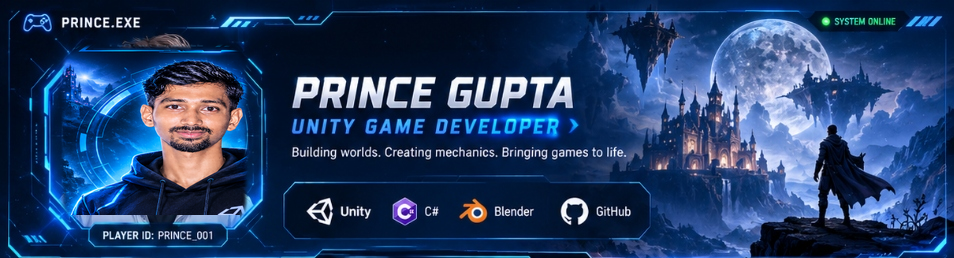
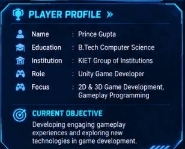
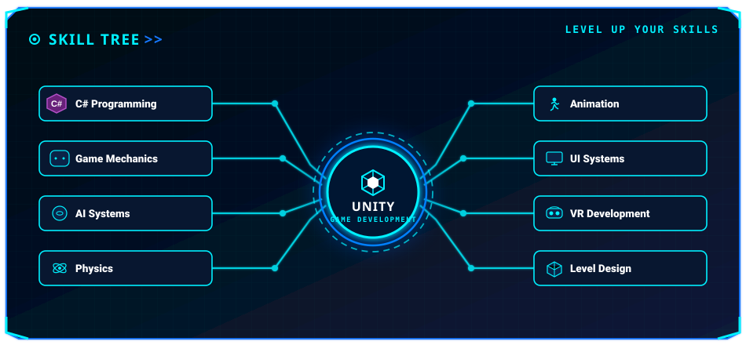
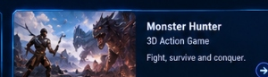
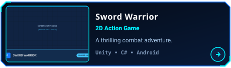
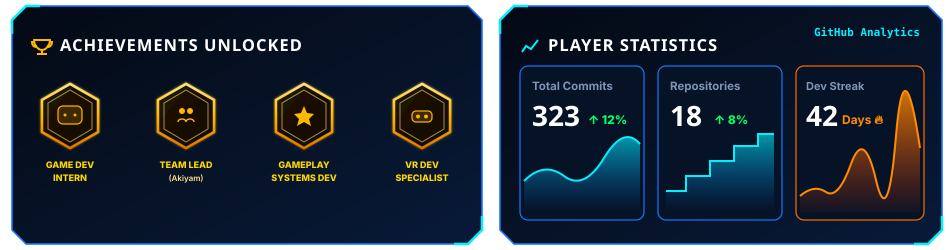
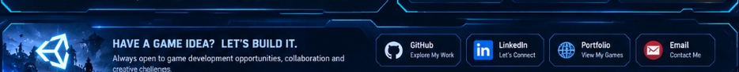
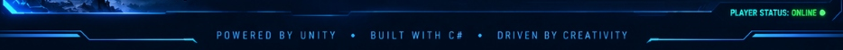

  <!-- TOP HERO BANNER (SVG) -->
  

    

  <!-- QUICK CONNECT CHANNELS -->
  
  &nbsp;
  
  &nbsp;
  
  &nbsp;
  

---

<!-- ROW 2: PLAYER PROFILE & SKILL TREE (SVG) -->
<table border="0" cellpadding="0" cellspacing="6" width="100%">
  <tr>
    <td width="33.5%" valign="top">
      
    </td>
    <td width="66.5%" valign="top">
      
    </td>
  </tr>
</table>

---

<!-- ROW 3: MISSION SELECT / GAME PORTFOLIO (SVG) -->

  

 

<table border="0" cellpadding="0" cellspacing="6" width="100%">
  <tr>
    <td width="33.3%" align="center" valign="top">
      
       
      
      
    </td>
    <td width="33.3%" align="center" valign="top">
      
       
      
      
    </td>
    <td width="33.3%" align="center" valign="top">
      
       
      
      
    </td>
  </tr>
  <tr>
    <td width="33.3%" align="center" valign="top">
      
       
      
      
    </td>
    <td width="33.3%" align="center" valign="top">
      
       
      
      
    </td>
    <td width="33.3%" align="center" valign="top">
      
       
      
      
    </td>
  </tr>
</table>

<b>🔍 Tap to View Detailed Mission Briefing & Architecture</b>

 

| Mission | Engine / Stack | Key Mechanics & Architecture |
|:---|:---|:---|
| **M01: The Silent City** | Unity • C# • Android | Three-lane runner movement, swipe input, Cinemachine follow camera with dynamic shake, three-hit health, obstacle pooling, audio management. |
| **M02: Monster Hunter** | Unity • C# • PC | Third-person combat, NavMeshAgent AI (Patrol, Chase, Attack), raycast line-of-sight detection, animation-event hitboxes, checkpoint system. |
| **M03: Sword Warrior** | Unity • C# • Android | 2D melee combat, virtual joystick input, multi-hit combo mechanics, BoxCollider2D/CircleCollider2D hitboxes, invincibility frames, enemy spawning. |
| **M04: Legends of Tretayug** | Unity • C# • Team Lead | Hades-inspired roguelike, ScriptableObject-driven boon system, room state progression (Locked/Combat/Cleared), combat feel, Git collaboration. |
| **M05: Triathlon: Endurance** | Unity • C# • PC | 3-in-1 multi-stage sports simulation (Running, Swimming with oxygen mechanics, Cycling with cadence & stamina), level design. |
| **M06: VR Shape Puzzle** | Unity 6 • Meta XR • OpenXR | Hand tracking & Touch controllers, physics grab/release, shape snapping, throw velocity physics, wrist UI menu, haptic feedback. |

---

<!-- ROW 4: ACHIEVEMENTS & PLAYER STATISTICS (SVG) -->
<table border="0" cellpadding="0" cellspacing="6" width="100%">
  <tr>
    <td width="52%" valign="top">
      
    </td>
    <td width="48%" valign="top">
      
    </td>
  </tr>
</table>

   
  <!-- LIVE GITHUB METRICS IN CYBER HUD THEME -->
  
  
    
  

---

<!-- ROW 5: CONTACT BANNER (SVG) -->

  

    

  | CHANNEL | LINK | DESCRIPTION |
  |:---|:---|:---|
  | 💻 **GitHub** | [princekr77](https://github.com/princekr77) | Source code & game projects |
  | 💼 **LinkedIn** | [Prince Gupta](https://www.linkedin.com/in/prince-gupta-b98189330) | Professional network & updates |
  | 📧 **Email** | [princekr2927@gmail.com](mailto:princekr2927@gmail.com) | Direct communication & queries |
  | 🎮 **Itch.io** | [gamedevprince](https://gamedevprince.itch.io) | Playable game builds & web demos |

---

<!-- ROW 6: FOOTER (SVG) -->

  
   
  © 2026 PRINCE.EXE — Player Profile • All systems operational.

