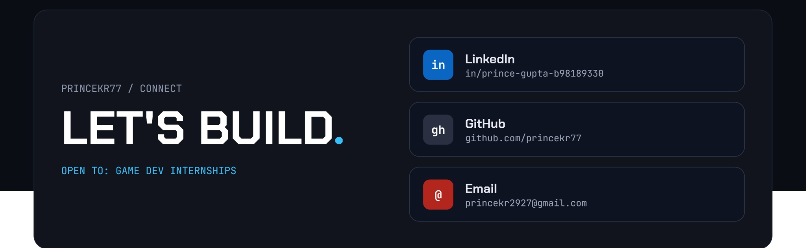

  <!-- ========================================================================= -->
  <!-- 01: INTRO / HERO (PRINCEKR77 / INTRO)                                     -->
  <!-- ========================================================================= -->
  

    

  <!-- ========================================================================= -->
  <!-- 02: ABOUT / WHAT I BUILD & QUEST LOG (PRINCEKR77 / ABOUT)                 -->
  <!-- ========================================================================= -->
  

    

  <!-- ========================================================================= -->
  <!-- 03: STACK / SKILL TREE (PRINCEKR77 / STACK)                               -->
  <!-- ========================================================================= -->
  

    

  <!-- ========================================================================= -->
  <!-- 04: STATS / DEV PASS & BY THE NUMBERS (PRINCEKR77 / STATS)                -->
  <!-- ========================================================================= -->
  

    

  <!-- ========================================================================= -->
  <!-- 05: PROJECTS / LEVELS (PRINCEKR77 / PROJECTS)                             -->
  <!-- ========================================================================= -->
  

<!-- DIRECT ACTION LINKS FOR PROJECTS -->

  🎮 <b><a href="https://github.com/princekr77/The-Silent-City-Echo-Run">The Silent City</a></b>: <a href="https://github.com/princekr77/The-Silent-City-Echo-Run">Source Code</a> &bull; <a href="https://gamedevprince.itch.io/the-silent-city">Playable Demo (Itch.io)</a>
  &nbsp;&nbsp;•&nbsp;&nbsp;
  ⚔️ <b><a href="https://github.com/princekr77/Monster_Hunter2.0">Monster Hunter</a></b>: <a href="https://github.com/princekr77/Monster_Hunter2.0">Source Code</a>
   
  🗡️ <b><a href="https://github.com/princekr77/Sword_Warrior">Sword Warrior</a></b>: <a href="https://github.com/princekr77/Sword_Warrior">Source Code</a> &bull; <a href="https://github.com/princekr77/Sword_Warrior">Download APK</a>
  &nbsp;&nbsp;•&nbsp;&nbsp;
  🏹 <b><a href="https://github.com/princekr77">Legend of Tretaya</a></b>: <a href="https://github.com/princekr77">Project Page</a>

 

  <!-- ========================================================================= -->
  <!-- 06: EXPERIENCE / SAVE POINTS (PRINCEKR77 / EXPERIENCE)                    -->
  <!-- ========================================================================= -->
  

    

  <!-- ========================================================================= -->
  <!-- 07: CONNECT / LET'S BUILD (PRINCEKR77 / CONNECT)                          -->
  <!-- ========================================================================= -->
  

    

  <!-- DIRECT CLICKABLE CONTACT LINKS -->
  

    <a href="https://www.linkedin.com/in/prince-gupta-b98189330"><b>LinkedIn</b></a>
    &nbsp;&nbsp;·&nbsp;&nbsp;
    <a href="https://gamedevprince.itch.io"><b>Portfolio</b></a>
    &nbsp;&nbsp;·&nbsp;&nbsp;
    <a href="mailto:princekr2927@gmail.com"><b>Email</b></a>
    &nbsp;&nbsp;·&nbsp;&nbsp;
    <a href="https://github.com/princekr77"><b>GitHub</b></a>
  

