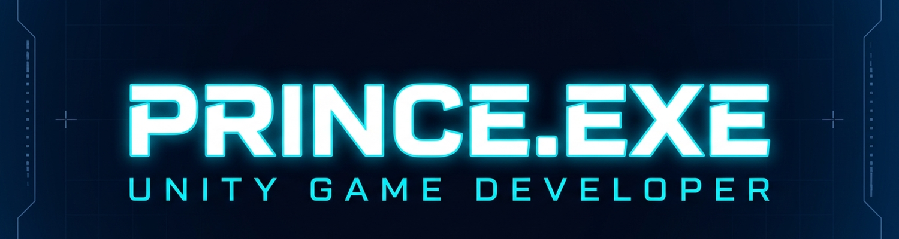
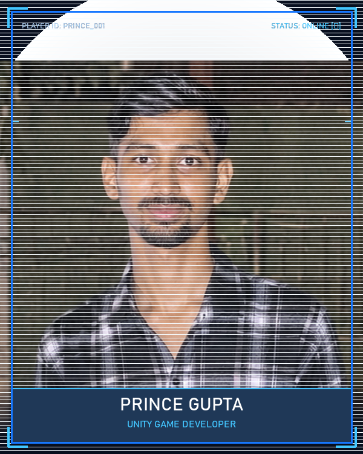
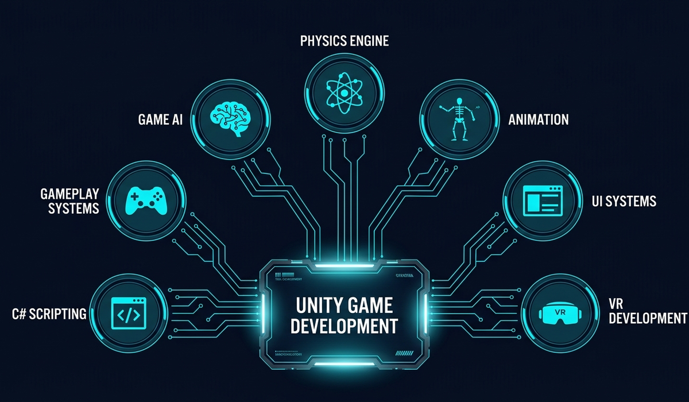
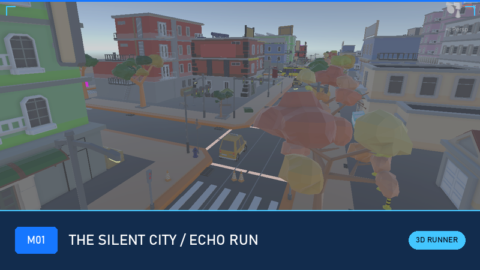
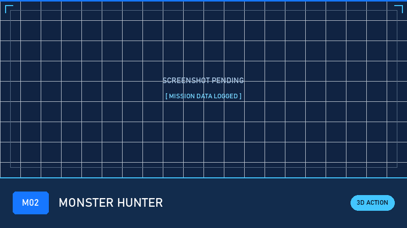
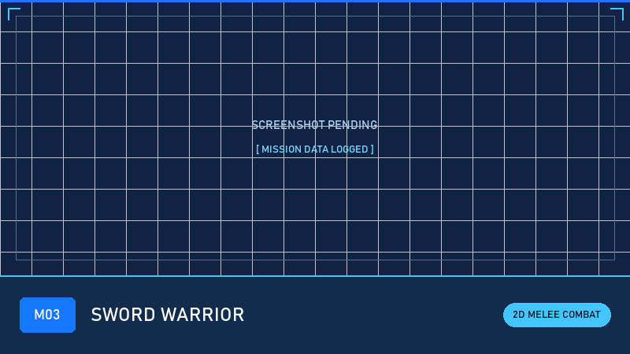
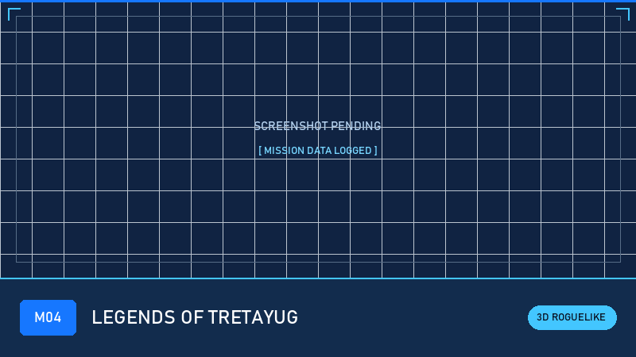
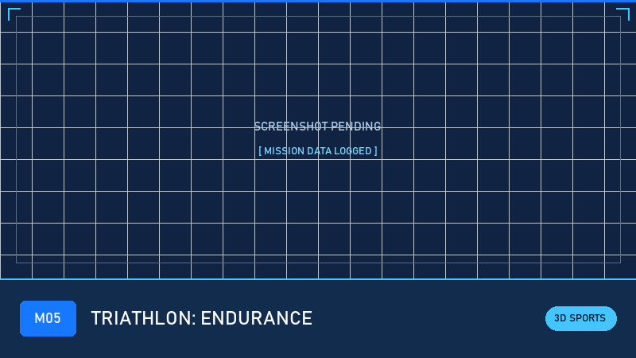
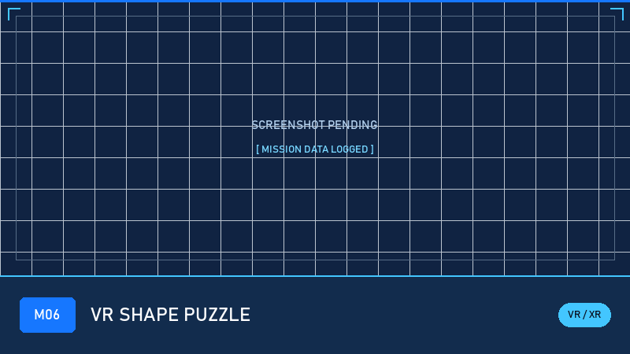
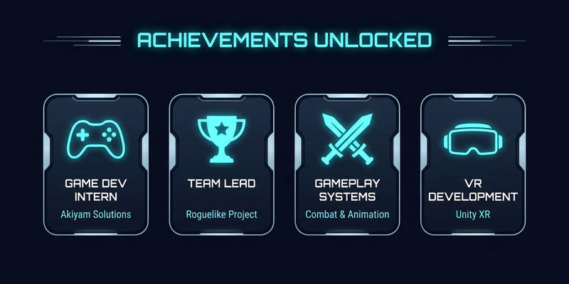

<div align="center">
  
  <br/>
  
  ```text
  PLAYER PROFILE  •  PLAYER ID: PRINCE_001  •  SYSTEM STATUS: ONLINE
  ```
  
  <br/>
  
  <a href="https://github.com/princekr77">
    
  </a>
  <a href="https://www.linkedin.com/in/prince-gupta-b98189330">
    
  </a>
  <a href="mailto:princekr2927@gmail.com">
    
  </a>
  
  <br/><br/>
  
  > **"Building worlds. Creating mechanics. Bringing games to life."**

</div>

---

## `>_` PLAYER PROFILE

<table>
<tr>
<td width="38%" align="center" valign="top">



<br/><br/>

<pre>
┌─────────────────────────┐
│  PLAYER ID: PRINCE_001  │
│  CLASS: GAME DEVELOPER  │
│  GUILD: UNITY           │
│  STATUS: ONLINE         │
└─────────────────────────┘
</pre>

</td>
<td width="62%" valign="top">

### PRINCE GUPTA
**UNITY GAME DEVELOPER**  
`B.Tech Computer Science — KIET Group of Institutions`

---

**PRIMARY ENGINE:** Unity  
**PRIMARY LANGUAGE:** C#  

**SPECIALIZATION**
- 2D & 3D Game Development
- Gameplay Programming
- Game Mechanics
- AI Systems (NavMesh & State Machines)
- Physics & Collision
- Animation Systems & Rigging
- VR Interaction Design

---

**BRIEFING**
> I am a Unity Game Developer passionate about building interactive gameplay experiences, developing game mechanics, and creating immersive 2D and 3D worlds using Unity and C#.

---

**CURRENT OBJECTIVE**
- ▸ Seeking a Game Development Internship
- ▸ Building advanced gameplay & combat systems
- ▸ Exploring VR interaction & spatial design

</td>
</tr>
</table>

<div align="center">
  <br/>
  <b>CORE TECH STACK</b><br/><br/>
  
  
  
  
  
</div>

---

## `>_` SKILL TREE

<div align="center">
  
</div>

<table align="center" width="100%">
<tr>
<td align="center" width="16%" valign="top">
<b>GAME ENGINE</b><br/><br/>
Unity<br/>
Unity 2D<br/>
Unity 3D<br/>
URP Pipeline
</td>
<td align="center" width="16%" valign="top">
<b>PROGRAMMING</b><br/><br/>
C# Scripting<br/>
C++<br/>
OOP Architecture<br/>
Data Structures
</td>
<td align="center" width="16%" valign="top">
<b>GAMEPLAY</b><br/><br/>
Player Controllers<br/>
Combat Systems<br/>
Object Pooling<br/>
Health & Damage<br/>
Scene Management
</td>
<td align="center" width="16%" valign="top">
<b>GAME AI</b><br/><br/>
NavMeshAgent<br/>
Enemy Patrol & Chase<br/>
Attack State Machines<br/>
Raycast Detection
</td>
<td align="center" width="16%" valign="top">
<b>PHYSICS</b><br/><br/>
Rigidbody Dynamics<br/>
Colliders & Triggers<br/>
Raycasting<br/>
Hitbox / Hurtbox
</td>
<td align="center" width="16%" valign="top">
<b>ANIMATION & VR</b><br/><br/>
Animator State Machines<br/>
Animation Events<br/>
Meta XR SDK<br/>
Hand Tracking
</td>
</tr>
</table>

<div align="center">
  <br/>
  <b>DEVELOPMENT TOOLS</b><br/><br/>
  
  
  
  
  <br/><br/>
  <b>IMMERSIVE DEVELOPMENT</b><br/><br/>
  
  
  
  
</div>

---

## `>_` MISSION SELECT

> **Select a mission to explore the game build, source code, and feature set.**

<table>
<tr>
<td width="50%" valign="top">



### `M01` THE SILENT CITY / ECHO RUN
**Genre:** 3D Story Endless Runner  
**Platform:** Android • **Engine:** Unity • **Language:** C#  

A 3D story-based endless runner set in a post-apocalyptic world. A meteor impact freezes the city in time — the player must keep running through looping frozen city tiles to survive.

**FEATURES**
- Three-lane movement system & swipe input
- Cinemachine follow camera with dynamic shake
- Three-hit health system & obstacle collision
- Object pooling for infinite looping tiles
- Story progression & audio management

<br/>

[](https://github.com/princekr77/The-Silent-City-Echo-Run)
[](https://gamedevprince.itch.io/the-silent-city)

</td>
<td width="50%" valign="top">



### `M02` MONSTER HUNTER
**Genre:** 3D Third-Person Action  
**Platform:** PC (Windows / Mac / Linux) • **Engine:** Unity • **Language:** C#  

A third-person action game featuring responsive player combat, enemy AI behavior, and interactive combat mechanics in 3D arenas.

**FEATURES**
- Third-person player controller & camera
- Mouse-based combo attack mechanics
- Enemy AI using NavMeshAgent (Patrol / Chase / Attack)
- Raycast line-of-sight detection
- Animation-event synchronized hitboxes
- Checkpoint & respawn system

<br/>

[](https://github.com/princekr77/Monster_Hunter2.0)
[](#)

</td>
</tr>

<tr>
<td width="50%" valign="top">



### `M03` SWORD WARRIOR
**Genre:** 2D Action / Melee Combat  
**Platform:** Android • **Engine:** Unity • **Language:** C#  

A fast-paced 2D action game featuring melee sword combat, enemy AI behaviors, and mobile touch joystick controls.

**FEATURES**
- Virtual joystick & attack button controls
- Multi-hit combo combat system
- Enemy AI state machines
- BoxCollider2D hitboxes & CircleCollider2D hurtboxes
- Invincibility frames & hit-stop feedback
- Dynamic enemy spawning system

<br/>

[](https://github.com/princekr77/Sword_Warrior)
[](#)

</td>
<td width="50%" valign="top">



### `M04` LEGENDS OF TRETAYUG
**Genre:** 3D Roguelike Action  
**Engine:** Unity • **Role:** Team Lead / Game Developer  

A mythology-inspired roguelike project inspired by Hades-style gameplay, featuring room-based progression, player combat, divine boons, and enemy encounters.

**DEVELOPMENT CONTRIBUTIONS**
- Player combat & animation systems
- ScriptableObject-driven divine boon architecture
- Room management (Locked / In Combat / Cleared)
- UI events & scene management
- Team leadership & Git collaboration

<br/>

[](https://github.com/princekr77)
[](#)

</td>
</tr>

<tr>
<td width="50%" valign="top">



### `M05` TRIATHLON: ENDURANCE
**Genre:** 3D Sports Game  
**Platform:** PC / Windows • **Engine:** Unity • **Language:** C#  

A realistic 3D triathlon game prototype seamlessly combining three sports disciplines into a unified multi-stage experience.

**DISCIPLINES**
1. Running (lane-based pacing & stamina)
2. Swimming (water environment & oxygen management)
3. Cycling (cadence mechanics & road navigation)

**DEVELOPMENT FEATURES**
- Multi-sport gameplay state controllers
- Dynamic stamina and oxygen systems
- Level design & sports environment assets
- Desktop game UI & HUD overlays

<br/>

[](https://github.com/princekr77)
[](#)

</td>
<td width="50%" valign="top">



### `M06` VR SHAPE PUZZLE
**Genre:** Virtual Reality Puzzle  
**Engine:** Unity 6 • **Tech:** URP, Meta XR SDK, OpenXR  

An interactive VR puzzle experience featuring hand tracking, Touch controller interaction, spatial audio, and tactile object manipulation.

**FEATURES**
- Native Meta XR hand tracking & controller input
- Physics-based grab & release interactions
- Shape snapping with visual & audio feedback
- Object throw mechanics with velocity calculation
- In-game wrist menu & haptic feedback

<br/>

[](https://github.com/princekr77)
[](#)

</td>
</tr>
</table>

---

## `>_` CURRENT MISSION

```text
┌──────────────────────────────────────────────────────────────────┐
│           MISSION: BUILDING BETTER GAME EXPERIENCES              │
├──────────────────────────────────────────────────────────────────┤
│                                                                  │
│  ▸ Advanced Unity gameplay systems                               │
│  ▸ 3D environment & level design                                 │
│  ▸ Enemy AI & combat mechanics                                   │
│  ▸ VR interaction systems                                        │
│  ▸ Game optimization & performance                               │
│                                                                  │
│  STATUS: ● ACTIVE                                                │
│  MODE: CONTINUOUS LEARNING                                       │
│                                                                  │
└──────────────────────────────────────────────────────────────────┘
```

---

## `>_` ACHIEVEMENTS UNLOCKED

<div align="center">
  
</div>

<br/>

<table>
<tr>
<td width="50%" align="center" valign="top">

### 🎮 `ACHV_01` GAME DEVELOPMENT INTERN
**Akiyam Solutions Pvt. Ltd.**  
`Mar 2026 – Sep 2026`  
Certified Unity Game Developer & Team Lead. Contributed to multiple aspects of game development on *Legend of Tretaya*.

</td>
<td width="50%" align="center" valign="top">

### 🗡️ `ACHV_02` TEAM LEAD
Led and coordinated the development team — managed project requirements, assigned responsibilities, and supported team members through effective communication and problem-solving.

</td>
</tr>
<tr>
<td width="50%" align="center" valign="top">

### ⚔️ `ACHV_03` GAMEPLAY SYSTEMS DEVELOPER
Architected combat systems, player controllers, animation state machines, and a ScriptableObject-driven divine boon system.

</td>
<td width="50%" align="center" valign="top">

### 🥽 `ACHV_04` VR DEVELOPMENT
Developed a VR Shape Puzzle assessment using Unity 6, URP, Meta XR SDK, and OpenXR — covering hand tracking, grab/throw mechanics, and haptic feedback.

</td>
</tr>
</table>

<div align="center">
  <br/>
  <b>EXTRACURRICULAR</b><br/><br/>
  🏆 <b>Road Safety Hackathon 2025</b> — Team Leader, National Level<br/>
  <i>Proposed a solution to increase FOB usage for safer pedestrian crossings.</i><br/>
  <code>15 Jan 2025 – 07 Apr 2025</code>
</div>

---

## `>_` PLAYER STATISTICS

<div align="center">
  
  
  <br/><br/>
  
  <br/><br/>
  
</div>

---

## `>_` CONNECT TO PLAYER

<div align="center">

### HAVE A GAME IDEA? LET'S BUILD IT.
*Always open to game development opportunities, collaboration, and creative challenges.*

<br/>

<a href="https://github.com/princekr77">
  
</a>
<a href="https://www.linkedin.com/in/prince-gupta-b98189330">
  
</a>
<a href="mailto:princekr2927@gmail.com">
  
</a>
<a href="https://gamedevprince.itch.io">
  
</a>

<br/><br/>

| CHANNEL | LINK | DESCRIPTION |
|:---|:---|:---|
| 💻 **GitHub** | [princekr77](https://github.com/princekr77) | Source code & game repositories |
| 💼 **LinkedIn** | [Prince Gupta](https://www.linkedin.com/in/prince-gupta-b98189330) | Professional network & experience |
| 📧 **Email** | [princekr2927@gmail.com](mailto:princekr2927@gmail.com) | Direct communication & opportunities |
| 🎮 **Itch.io** | [gamedevprince](https://gamedevprince.itch.io) | Playable game builds & demos |

</div>

---

<div align="center">
  <br/>
  
  ```text
  ╔══════════════════════════════════════════════════════════════╗
  ║                                                              ║
  ║                   PLAYER STATUS: ● ONLINE                    ║
  ║                                                              ║
  ║     POWERED BY UNITY  •  BUILT WITH C#  •  DRIVEN BY PASSION ║
  ║                                                              ║
  ║          "Thanks for visiting my development world!"         ║
  ║                                                              ║
  ╚══════════════════════════════════════════════════════════════╝
  ```
  
  <br/>
  <sub>© 2026 PRINCE.EXE — Player Profile • All systems operational.</sub>
</div>
