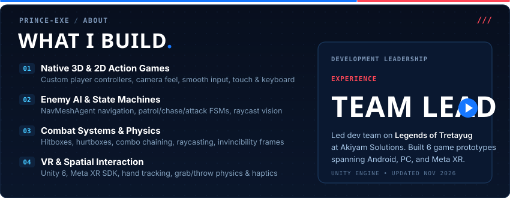
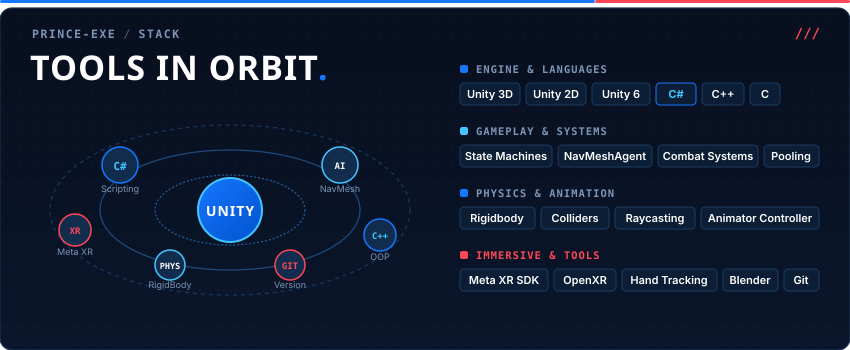
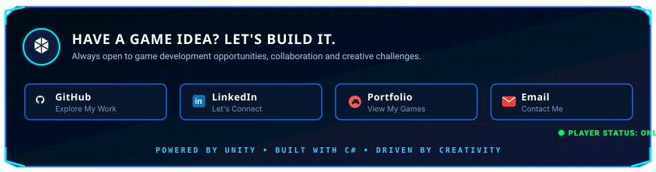

  <!-- 01: INTRO / HERO CARD -->
  

    

  <!-- 02: ABOUT / WHAT I BUILD -->
  

    

  <!-- 03: TECH STACK / TOOLS IN ORBIT -->
  

    

  <!-- 04: BY THE NUMBERS & DEV ID PASS -->
  

 

### `>_` Projects

| Project | What it is | Stack |
|:---|:---|:---|
| **[The Silent City / Echo Run](https://github.com/princekr77/The-Silent-City-Echo-Run)** | 3D story-driven endless runner set in a frozen city. Features three-lane movement, touch swipe controls, dynamic Cinemachine follow camera, three-hit health, and infinite looping tile pooling. &nbsp;•&nbsp; **[Playable Demo](https://gamedevprince.itch.io/the-silent-city)** | `Unity` • `C#` • `Android` • `URP` |
| **[Monster Hunter](https://github.com/princekr77/Monster_Hunter2.0)** | Third-person 3D action game featuring player combat mechanics, enemy AI using NavMeshAgent (Patrol, Chase, Attack states), raycast line-of-sight vision, and animation-event hitboxes. | `Unity` • `C#` • `PC (Win/Mac)` |
| **[Sword Warrior](https://github.com/princekr77/Sword_Warrior)** | 2D action game featuring melee sword combat, virtual joystick controls, combo attack system, BoxCollider2D hitboxes, CircleCollider2D hurtboxes, and invincibility frames. | `Unity` • `C#` • `Android` |
| **[Legends of Tretayug](https://github.com/princekr77)** | Mythology-inspired 3D roguelike action game inspired by Hades. Room-based progression, ScriptableObject-driven divine boon system, enemy encounters, and combat animation flow. | `Unity` • `C#` • `Team Lead` |
| **[Triathlon: Endurance](https://github.com/princekr77)** | 3D sports game prototype combining three disciplines: Running (lane movement), Swimming (water environment & oxygen mechanics), and Cycling (cadence & stamina). | `Unity` • `C#` • `PC / Windows` |
| **[VR Shape Puzzle](https://github.com/princekr77)** | Interactive VR puzzle assessment built in Unity 6. Native Meta XR hand tracking & Touch controllers, physics grab/release, shape snapping, velocity throw mechanics, and haptic feedback. | `Unity 6` • `Meta XR SDK` • `OpenXR` |

 

  <!-- 05: CONNECT / LET'S BUILD -->
  

    

  <!-- CLICKABLE CONTACT LINKS DIRECTLY BELOW CARD -->
  

    
    &nbsp;&nbsp;
    
    &nbsp;&nbsp;
    
    &nbsp;&nbsp;
    
  

  

    <b><a href="https://www.linkedin.com/in/prince-gupta-b98189330">LinkedIn</a></b> &nbsp;•&nbsp; 
    <b><a href="https://gamedevprince.itch.io">Itch.io Portfolio</a></b> &nbsp;•&nbsp; 
    <b><a href="mailto:princekr2927@gmail.com">Email</a></b> &nbsp;•&nbsp; 
    <b><a href="https://github.com/princekr77">GitHub</a></b>
  

   
  © 2026 PRINCE.EXE — Hand-crafted vector architecture • All systems operational.

