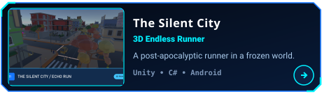
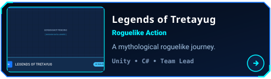
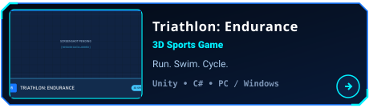
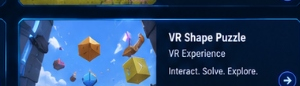

  <!-- ========================================================================= -->
  <!-- 01: HERO & STATUS BANNER (PRINCE.EXE // SYSTEM ONLINE)                    -->
  <!-- ========================================================================= -->
  

    

  <!-- ========================================================================= -->
  <!-- 02: PLAYER PROFILE & CURRENT OBJECTIVE                                    -->
  <!-- ========================================================================= -->
  

    

  <!-- ========================================================================= -->
  <!-- 03: SKILL TREE & TECH MATRIX                                              -->
  <!-- ========================================================================= -->
  

    

  <!-- ========================================================================= -->
  <!-- 04: MISSION SELECT — GAME PORTFOLIO HEADER                                -->
  <!-- ========================================================================= -->
  

<!-- 6 CLICKABLE MISSION CARDS IN RESPONSIVE GRID -->
<table width="100%" border="0" cellspacing="10" cellpadding="0">
  <tr>
    <td width="50%" valign="top">
      
    </td>
    <td width="50%" valign="top">
      
    </td>
  </tr>
  <tr>
    <td width="50%" valign="top">
      
    </td>
    <td width="50%" valign="top">
      
    </td>
  </tr>
  <tr>
    <td width="50%" valign="top">
      
    </td>
    <td width="50%" valign="top">
      
    </td>
  </tr>
</table>

 

### `>_` Mission Logs &amp; Deployment Specs

| Project | Genre / Focus | Architecture &amp; Mechanics | Stack |
|:---|:---|:---|:---|
| **[The Silent City / Echo Run](https://github.com/princekr77/The-Silent-City-Echo-Run)** | 3D Endless Runner | Story-driven runner set in a frozen city. Three-lane movement, touch swipe input, dynamic Cinemachine follow camera, 3-hit health state machine, infinite tile pooling. &nbsp;•&nbsp; **[Playable Demo](https://gamedevprince.itch.io/the-silent-city)** | `Unity` • `C#` • `Android` • `URP` |
| **[Monster Hunter](https://github.com/princekr77/Monster_Hunter2.0)** | 3D Action Game | Third-person combat against agile monster AI. State machine (Patrol, Chase, Attack), raycast line-of-sight vision, animation-event hitboxes, stamina management. | `Unity` • `C#` • `PC (Win/Mac)` |
| **[Sword Warrior](https://github.com/princekr77/Sword_Warrior)** | 2D Action Game | Melee sword combat platformer with virtual joystick controls, branching combo attack system, BoxCollider2D hitboxes, hurtbox frames, and invincibility states. | `Unity` • `C#` • `Android` |
| **[Legends of Tretayug](https://github.com/princekr77)** | Roguelike Action | Mythology-inspired 3D roguelike inspired by Hades. Room-based procedural progression, ScriptableObject-driven divine boons, enemy mob encounters, fluid animation flow. | `Unity` • `C#` • `Team Lead` |
| **[Triathlon: Endurance](https://github.com/princekr77)** | 3D Sports Game | Multi-discipline sports prototype: Running (lane movement), Swimming (buoyancy & oxygen mechanics), and Cycling (cadence & stamina regulation). | `Unity` • `C#` • `PC / Windows` |
| **[VR Shape Puzzle](https://github.com/princekr77)** | VR Spatial Experience | Interactive spatial puzzle built in Unity 6. Meta XR hand tracking & Touch controllers, 6DOF physics grab/release, shape snapping, velocity throw, and haptics. | `Unity 6` • `Meta XR SDK` • `OpenXR` |

 

  <!-- ========================================================================= -->
  <!-- 05: ACHIEVEMENTS UNLOCKED & PLAYER STATISTICS                             -->
  <!-- ========================================================================= -->
  

    

  <!-- ========================================================================= -->
  <!-- 06: HAVE A GAME IDEA? LET'S BUILD IT. // CONNECT                          -->
  <!-- ========================================================================= -->
  

    

  <!-- CLICKABLE CONNECT SHIELDS -->
  

    
    &nbsp;&nbsp;
    
    &nbsp;&nbsp;
    
    &nbsp;&nbsp;
    
  

  

    <b><a href="https://www.linkedin.com/in/prince-gupta-b98189330">LinkedIn Profile</a></b> &nbsp;•&nbsp; 
    <b><a href="https://gamedevprince.itch.io">Playable Itch.io Demos</a></b> &nbsp;•&nbsp; 
    <b><a href="mailto:princekr2927@gmail.com">Direct Email</a></b> &nbsp;•&nbsp; 
    <b><a href="https://github.com/princekr77">GitHub Repositories</a></b>
  

   
  © 2026 PRINCE.EXE — Gamified HUD Architecture • All systems operational • Powered by Unity &amp; C#.

