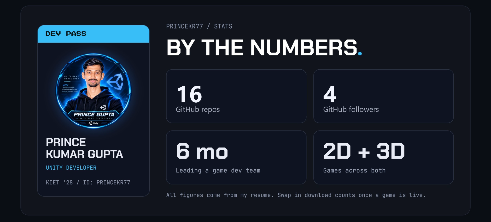
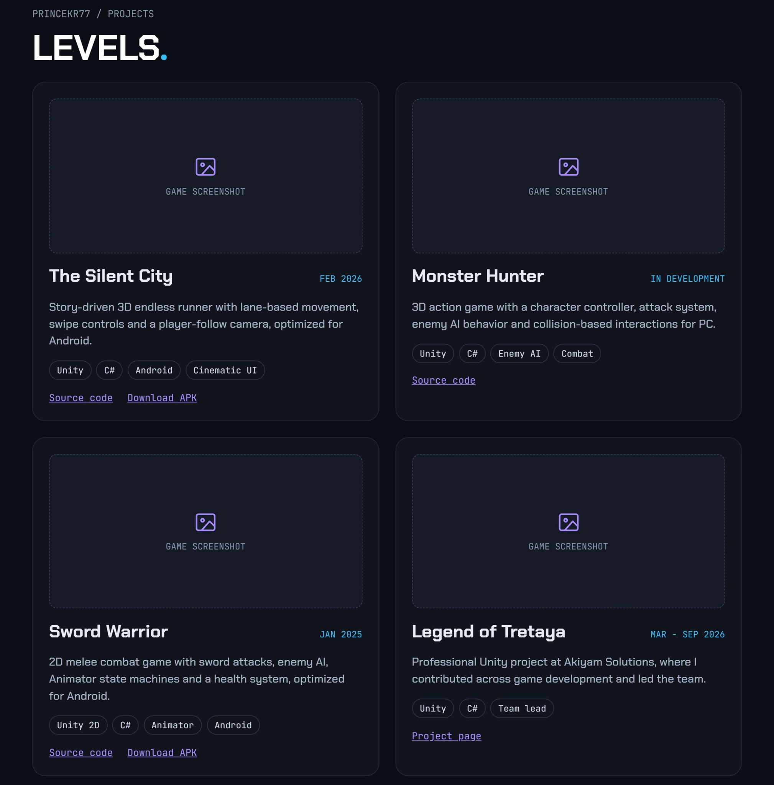
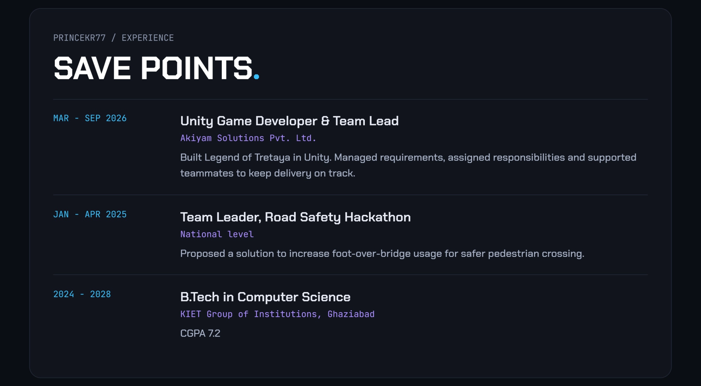

<!-- ========================================== -->
<!-- 01. INTRO / HERO                           -->
<!-- ========================================== -->

<!-- ========================================== -->
<!-- 02. ABOUT / WHAT I BUILD                   -->
<!-- ========================================== -->

<!-- ========================================== -->
<!-- 03. SKILL TREE / TECH STACK                -->
<!-- ========================================== -->

<!-- ========================================== -->
<!-- 04. DEV PASS & LIVE BY THE NUMBERS         -->
<!-- ========================================== -->

<!-- ========================================== -->
<!-- 05. PROJECTS / MISSION SELECT              -->
<!-- ========================================== -->

<!-- Interactive Quick Links for Projects -->

  <b>The Silent City:</b> <a href="https://github.com/princekr77">Source Code</a> &bull; <a href="https://github.com/princekr77">Download APK</a> &nbsp;|&nbsp;
  <b>Monster Hunter:</b> <a href="https://github.com/princekr77">Source Code</a> 
  <b>Sword Warrior:</b> <a href="https://github.com/princekr77">Source Code</a> &bull; <a href="https://github.com/princekr77">Download APK</a> &nbsp;|&nbsp;
  <b>Legend of Tretaya:</b> <a href="https://github.com/princekr77">Project Page</a>

<!-- ========================================== -->
<!-- 06. EXPERIENCE / SAVE POINTS               -->
<!-- ========================================== -->

<!-- ========================================== -->
<!-- 07. CONNECT / LET'S BUILD                  -->
<!-- ========================================== -->

<!-- Interactive Social Badges -->

  
  &nbsp;
  
  &nbsp;
  

---

  🎮 Designed with Figma &bull; Powered by Unity &bull; Live GitHub Actions Sync

